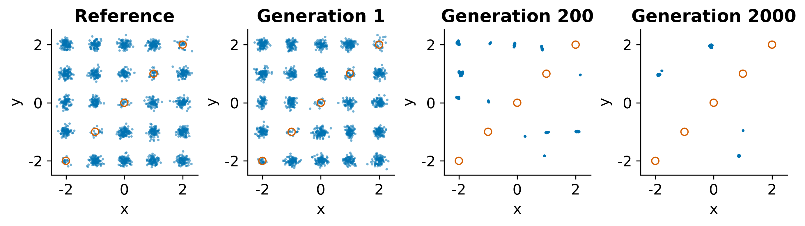
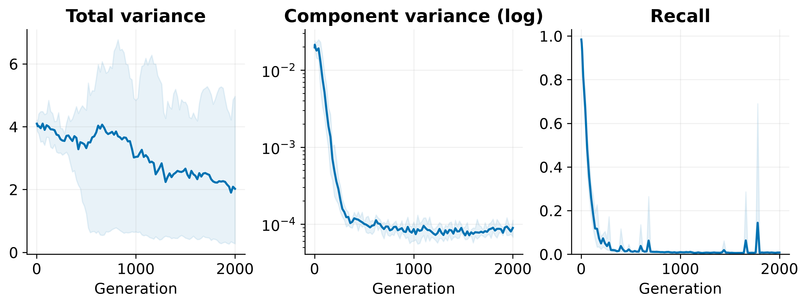
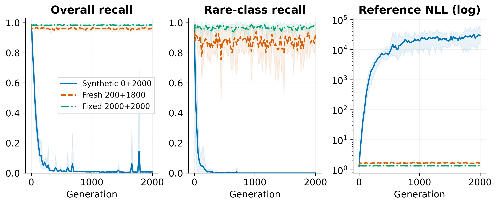
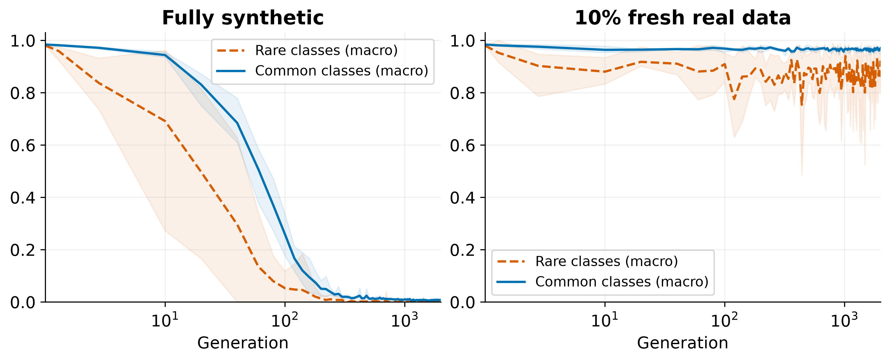
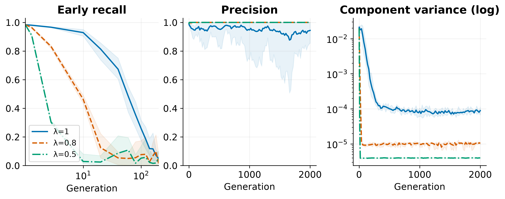
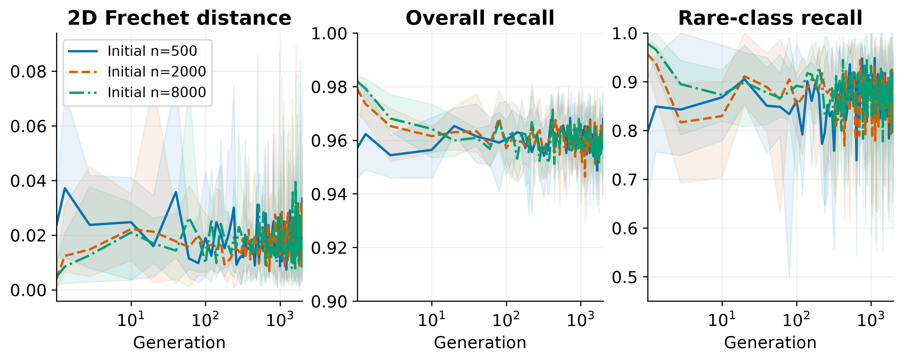
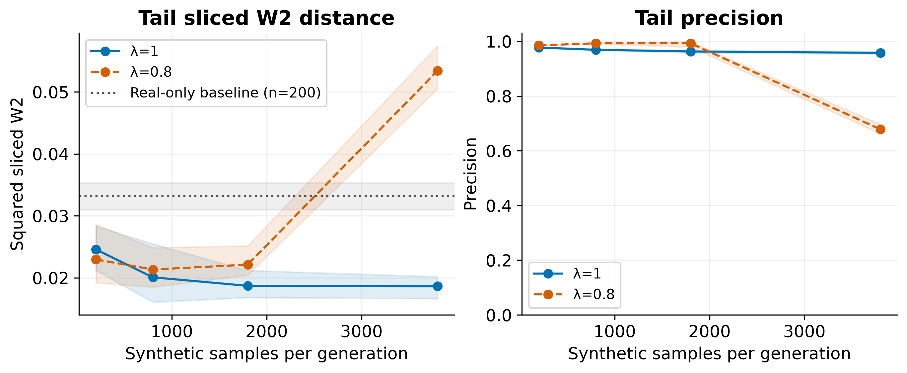
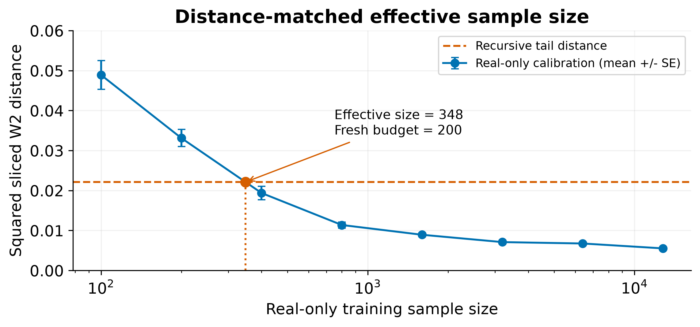

# Recursive Training of Imbalanced Gaussian Mixtures

**Real Data Anchoring and Sampling Bias in Recursive Training of Imbalanced Gaussian Mixtures**

GAO Jiashen · HKUST · 5003 Stochastic Processes and Applications

This project studies model collapse when Gaussian mixture models (GMMs) are repeatedly trained on their own samples. It reproduces recursive-training experiments from *Self-Consuming Generative Models Go MAD* on an imbalanced, two-dimensional mixture.

**[Read the paper](paper/manuscript.pdf)** · [Editable manuscript](paper/manuscript.md) · [Figures](paper/figures) · [Numerical results](paper/data/results.json)

## Completed work, in paper order

### 1. Target distribution and first-generation model

The target contains 25 Gaussian components on a 5 × 5 grid. Five diagonal components have weight 0.01 each; the remaining 20 have weight 0.0475 each. All component covariances are 0.01 I.

We drew 2,000 initial observations with seed 42, fitted the first-generation GMM, generated 2,000 observations, and compared their distributions. The original 2,000 observations remain the fixed reference throughout the recursive experiments. Evaluation includes overall and per-class Fréchet distance, precision, and recall. Classes are assigned to the nearest true component center; precision and recall use k = 5 nearest-neighbor neighborhoods. Fréchet distance uses raw two-dimensional coordinates.

Source: [`generate_initial_samples.py`](code/generate_initial_samples.py), [`train_first_generation.py`](code/train_first_generation.py), and the [shared implementation](code/gmm_experiment_common.py).

### 2. Fully synthetic training: diversity and minority support

Each new generation is fitted to 2,000 samples from the preceding model. Experiments run to generation 2,000 with five seeds (0–4). The paper uses the unbiased CUDA experiment, `sampling_bias/lambda_1`, as its fully synthetic control.

By generation 2,000, mean recall falls to **0.0076**, and rare-class recall reaches **zero**. Component variance contracts while precision remains 0.9440, demonstrating the need to track both precision and recall.





Source: [`run_sampling_bias.py`](code/run_sampling_bias.py) with λ = 1. The earlier implementation is [`run_full_synthetic.py`](code/run_full_synthetic.py).

### 3. Real-data supply: fresh data and fixed-real augmentation

Two real-data regimes were completed: **10% fresh real data**, with 200 newly drawn real and 1,800 synthetic observations per generation; and **fixed-real augmentation**, reusing the original 2,000 observations alongside 2,000 newly generated synthetic observations.

The following values are means across five seeds at generation 2,000.

| Training regime | Precision | Recall | Rare-class recall | 2D Fréchet distance |
| --- | ---: | ---: | ---: | ---: |
| Fully synthetic | 0.9440 | 0.0076 | 0.0000 | 4.4365 |
| 10% fresh real | 0.9658 | 0.9666 | 0.9227 | 0.0201 |
| Fixed-real augmentation | 0.9849 | 0.9852 | 0.9892 | 0.0038 |

Both real-data regimes cover all 25 mode neighborhoods in every seed at the final generation. Fixed-real augmentation achieves the highest terminal recall, while a 10% fresh-data stream sustains high coverage over 2,000 generations.





Source: [`run_fresh10.py`](code/run_fresh10.py) and [`run_fixed_real.py`](code/run_fixed_real.py). The [100% fresh-data script](code/run_fresh100.py) is provided; that experiment was not run.

### 4. Sampling bias and covariance contraction

Synthetic sampling uses covariance λΣ, with λ ∈ {1, 0.8, 0.5}. Smaller λ concentrates samples around component centers.

| Sampling factor λ | First recorded generation with recall < 0.5 | Terminal recall | Terminal precision |
| --- | --- | ---: | ---: |
| 1.0 | 60–80 across seeds | 0.0076 | 0.9440 |
| 0.8 | 10 in every seed | 0.0005 | 1.0000 |
| 0.5 | 5 in every seed | 0.0000 | 1.0000 |

Bias accelerates support loss. High terminal precision accompanies vanishing recall as samples concentrate around a small subset of the reference distribution.



Source: [`run_sampling_bias.py`](code/run_sampling_bias.py).

### 5. Initial-model influence under a common fresh-data supply

Initial GMMs use 500, 2,000, or 8,000 observations. Subsequent generations use 200 fresh and 1,800 synthetic observations. Tail statistics average generations 1,501–2,000 and then average across five seeds.

| Initial training size | Initial recall | Tail recall | Tail rare-class recall |
| --- | ---: | ---: | ---: |
| 500 | 0.9572 | 0.9587 | 0.8641 |
| 2,000 | 0.9790 | 0.9593 | 0.8712 |
| 8,000 | 0.9819 | 0.9586 | 0.8774 |

The initial overall-recall gap contracts substantially under a common fresh-data stream. Late-stage overall recall becomes similar, while rare-class coverage retains a smaller dependence on initialization.



Source: [`run_initialization_memory.py`](code/run_initialization_memory.py).

### 6. Effective sample size and the synthetic-data benefit boundary

Each generation receives 200 fresh observations and a synthetic budget of 200, 800, 1,800, or 3,800, at λ = 1 or 0.8. Real-only calibration uses eight sample sizes from 100 to 12,800 with 50 independent fits each, totaling 400 fits. Utility is measured by tail squared sliced Wasserstein distance to the reference.

| Synthetic observations per generation | Distance, λ = 1 | Distance, λ = 0.8 |
| --- | ---: | ---: |
| 200 | 0.02456 | 0.02295 |
| 800 | 0.02006 | 0.02132 |
| 1,800 | 0.01869 | 0.02212 |
| 3,800 | 0.01862 | 0.05339 |

The real-only baseline with 200 observations has mean distance **0.03313**. Unbiased augmentation improves this distance with diminishing returns. With biased sampling, 3,800 synthetic observations increase distance above the baseline, locating a benefit boundary within the tested budgets.

For λ = 0.8 and 1,800 synthetic observations, all five seeds satisfy the tail criterion. Distance matching gives an effective sample size of approximately **348**, or **1.74 times** the 200 fresh observations supplied per generation.





Source: [`run_effective_sample_size.py`](code/run_effective_sample_size.py).

## Paper

- [English manuscript PDF](paper/manuscript.pdf)
- [Editable manuscript](paper/manuscript.md)
- [LaTeX source](paper/manuscript.tex)
- [Saved report inputs](paper/data/report_inputs.zip)
- [Publication figures](paper/figures): eight figures, each in PDF and 300-DPI PNG.
- [Numerical results](paper/data/results.json)

The article follows Abstract, Introduction, Methods, Results, Discussion, Conclusion, and References. The principal fully synthetic comparison uses the CUDA run in `outputs/sampling_bias/lambda_1`.

## Project layout

```text
paper/                 Current English article, figures and numerical tables
code/                  Training entry points and the shared GMM implementation
code/reporting/        Figure generation and LaTeX manuscript build scripts
settings/              Canonical unbalanced target GMM configuration
docs/                  Experiment design, reference materials and move log
tests/                 In-memory numerical and data-composition checks
outputs/               Initial data/model, experiment settings and summaries
```

The repository includes bootstrap data, the initial model, saved settings, and aggregate results. Local environments, dependency caches, recursive checkpoints, bulk sample arrays, intermediate plots, and historical report archives are excluded from Git. Training regenerates these artifacts under `outputs/`.

## Environment

Python 3.13, managed by uv. CUDA-enabled PyTorch is locked to the official cu128 package index.

```powershell
uv sync --locked --cache-dir .uv-cache
```

## Training entry points

| Script | Experiment |
| --- | --- |
| `generate_initial_samples.py` | Draw the initial 2,000 real observations |
| `train_first_generation.py` | Fit and evaluate the initial GMM |
| `run_full_synthetic.py` | Original fully synthetic trajectory |
| `run_fresh10.py` | 200 fresh and 1,800 synthetic observations per generation |
| `run_fresh100.py` | 2,000 newly drawn real observations per generation |
| `run_fixed_real.py` | Original 2,000 real plus 2,000 synthetic observations |
| `run_sampling_bias.py` | Fully synthetic training at lambda = 1, 0.8, 0.5 |
| `run_initialization_memory.py` | Initial sample sizes 500, 2,000 and 8,000 |
| `run_effective_sample_size.py` | Real-only calibration and synthetic-data utility |

All scripts are under `code/` and share `gmm_experiment_common.py`. The four reproduction entry points default to CUDA. The original full-synthetic entry defaults to CPU; select `--device cuda` for a new GPU run. Resume with the backend used by the saved checkpoint.

Continue the four reproduction experiments in order:

```powershell
foreach ($experimentFile in @('run_fixed_real.py','run_sampling_bias.py','run_initialization_memory.py','run_effective_sample_size.py')) { uv run --locked --cache-dir .uv-cache "code/$experimentFile" --resume; if ($LASTEXITCODE -ne 0) { break } }
```

Common options are `--generations`, `--seeds`, `--device`, `--eval-every`, `--k` and `--resume`. Effective-size work can be separated using `--phase calibrate`, `--phase loops` and `--phase analyze`.

## Rebuild the paper

These commands read saved results; they do not train models. LaTeX compilation requires `pdflatex` on PATH. From a fresh clone, first restore the saved metrics, calibration results, and sample snapshots needed by the figure builder:

```powershell
uv run --locked --cache-dir .uv-cache python -m zipfile -e paper/data/report_inputs.zip .
```

```powershell
uv run --locked --cache-dir .uv-cache code/reporting/build_figures.py
uv run --locked --cache-dir .uv-cache code/reporting/build_manuscript.py --compile
```

The Markdown manuscript is the editable source. The build script generates LaTeX and compiles the PDF. LaTeX auxiliary files and page previews are under `paper/_build/`.

## Checks

```powershell
uv run --locked --cache-dir .uv-cache python -m unittest discover -s tests -v
```

The checks use small in-memory arrays and do not launch training experiments.

## References

1. Alemohammad et al. *Self-Consuming Generative Models Go MAD*. 2023. [arXiv:2307.01850v1](https://arxiv.org/abs/2307.01850v1).
2. Heusel et al. *GANs Trained by a Two Time-Scale Update Rule Converge to a Local Nash Equilibrium*. NeurIPS, 2017. [arXiv:1706.08500](https://arxiv.org/abs/1706.08500).
3. Kynkäänniemi et al. *Improved Precision and Recall Metric for Assessing Generative Models*. NeurIPS, 2019. [arXiv:1904.06991](https://arxiv.org/abs/1904.06991).
