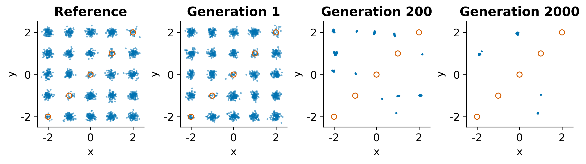
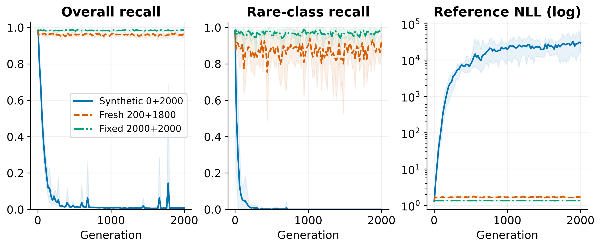
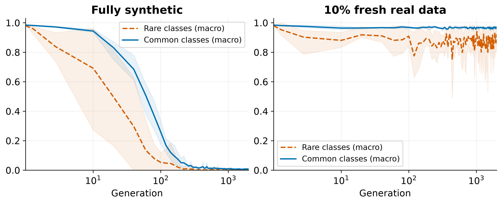
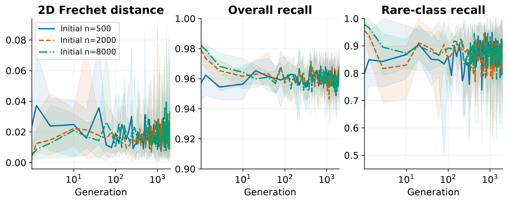

# Real Data Anchoring and Sampling Bias in Recursive Training of Imbalanced Gaussian Mixtures

GAO Jiashen

5003 Stochastic Processes and Applications

## Abstract

Recursive training feeds a generative model's samples into subsequent generations, allowing distributional errors to accumulate. We study this process in a two-dimensional Gaussian mixture with 25 components, including five rare components carrying a combined probability of 5%. Across five seeds and 2,000 generations, fully synthetic training reduces mean recall to 0.0076. Reusing the original real sample and introducing 10% fresh real data retain mean recall of 0.9852 and 0.9666, respectively. Covariance-biased sampling accelerates the loss of diversity: recall first falls below 0.5 at generations 60--80 under unbiased sampling, compared with generations 10 and 5 at bias factors 0.8 and 0.5. Different initial training sizes approach similar late-stage recall under a common fresh-data supply. With 200 fresh observations per generation, unbiased synthetic augmentation exhibits diminishing returns, whereas biased augmentation becomes harmful at 3,800 synthetic observations. These experiments connect minority-mode coverage, covariance contraction, and synthetic-data utility within a common recursive estimation framework.

## 1 Introduction

Generative models trained on their predecessors' outputs create a feedback loop between estimation and data generation. Alemohammad et al. [1] study fully synthetic, fixed-real augmentation, and fresh-real training loops, together with sampling mechanisms that favor high-density outputs. These mechanisms motivate a direct question for imbalanced data: how does recursive generation affect components that already receive a small fraction of the training observations?

Gaussian mixtures provide a setting in which component geometry, probability mass, and sampling variability can be examined together. We construct a 25-component mixture with five rare modes, then compare data-supply regimes, sampling bias, initial sample sizes, and synthetic-data budgets. The analysis follows both overall distributional accuracy and rare-class coverage. Its central finding is that preserving real-data support and controlling synthetic sampling are distinct requirements: abundant synthetic samples can maintain high precision while eliminating diversity, and their utility under a fixed fresh-data budget depends on sampling bias.

## 2 Methods

### 2.1 Target distribution and model estimation

The reference distribution is

$$p_r(x)=\sum_{k=1}^{25}w_k\,\mathcal{N}(x;\mu_k,0.01I_2).$$

The centers form the grid $\{-2,-1,0,1,2\}^2$. The five diagonal components have weight 0.01 each; the other 20 components have weight 0.0475 each. We draw 2,000 initial observations independently from this distribution and fit a full-covariance 25-component GMM. The resulting model initializes the main recursive experiments.

Every fit re-estimates all mixture weights, means, and covariances. Expectation maximization uses three k-means initializations, a maximum of 300 iterations, tolerance $10^{-4}$, and covariance regularization $\varepsilon I_2$ with $\varepsilon=10^{-6}$. Computation uses float64, with k-means initialization on the CPU and batched EM updates on an NVIDIA RTX 4050 GPU. Each recursive condition uses five random seeds and runs through generation 2,000. Training draws, initialization, and evaluation use separate random streams.

### 2.2 Recursive data supply and sampling bias

Let $M_t$ denote the model fitted at generation $t$. For $t\ge2$, the fully synthetic loop fits $M_t$ to 2,000 new samples from $M_{t-1}$. The fresh-real loop combines 200 newly drawn real observations with 1,800 samples from $M_{t-1}$. The fixed-real loop combines all 2,000 original real observations with 2,000 new predecessor-model samples. Synthetic observations are regenerated at each generation.

| Regime | Real observations per generation | Synthetic observations | Total |
| --- | --- | --- | --- |
| Fully synthetic | 0 | 2,000 | 2,000 |
| Fresh real | 200 newly drawn | 1,800 | 2,000 |
| Fixed real | 2,000 reused | 2,000 | 4,000 |

For biased sampling, component labels are drawn from the fitted weights and observations are generated according to

$$z\sim\operatorname{Categorical}(w),\qquad x\mid z=k\sim\mathcal{N}(\mu_k,\lambda\Sigma_k).$$

We compare $\lambda\in\{1,0.8,0.5\}$ in the fully synthetic loop. Bias acts on the synthetic training draws; evaluation samples are drawn from the fitted model with $\lambda=1$.

### 2.3 Evaluation

The initial 2,000 observations form the fixed empirical reference for every condition. Each evaluation independently draws 2,000 observations from the current model. Evaluations occur at generations 1, 2, 5, and 10, then every 20 generations. Lines represent means over five seeds, and shaded bands span the seed minimum and maximum. Terminal statistics refer to generation 2,000. Tail statistics average generations 1,501--2,000 within each seed before aggregation across seeds.

We evaluate the Fréchet statistic on the two coordinates [2], using sample covariance matrices with denominator $n-1$:

$$D_F=\|m_r-m_g\|^2+\operatorname{tr}\!\left(C_r+C_g-2(C_r^{1/2}C_gC_r^{1/2})^{1/2}\right).$$

Precision and recall use unions of fifth-nearest-neighbor balls [3]. Precision measures the fraction of generated observations covered by the real-sample neighborhood union; recall measures the fraction of reference observations covered by the generated-sample union. Points are assigned to the nearest true center for classwise evaluation. Rare-class and common-class summaries average available classwise estimates within their respective groups. A mode is counted as covered when a generated point falls within radius 0.4 of its true center.

Additional diagnostics are reference negative log likelihood, total covariance trace, and mean component covariance trace. Squared sliced Wasserstein distance averages one-dimensional empirical squared transport distances over 128 fixed directions in the plane. All distance evaluations use the same empirical reference.

### 2.4 Initial conditions and effective sample size

To examine initial-model memory, we fit initial models to nested samples of 500, 2,000, and 8,000 real observations for each seed. Subsequent generations use the same 200-fresh plus 1,800-synthetic schedule, with paired random streams across initial sizes.

To measure synthetic-data utility, we fix the fresh budget at $n_r=200$ and vary the synthetic budget over $n_s\in\{200,800,1800,3800\}$ for $\lambda\in\{1,0.8\}$. Real-only calibration uses 50 direct GMM fits at each training size $n\in\{100,200,400,800,1600,3200,6400,12800\}$. The effective sample size $n_e$ matches the recursive tail distance to the mean real-only calibration distance, using local interpolation in $\log n$ [1].

Effective-size estimates are reported when all five trajectories satisfy the tail criterion

$$\frac{|\overline D_{\mathrm{early}}-\overline D_{\mathrm{late}}|}{\overline D_{\mathrm{tail}}}\le0.2,$$

where early and late refer to the two halves of the final 500-generation window. The calibration match must have a unique crossing within the evaluated sample-size range.

## 3 Results

### 3.1 Fully synthetic training loses minority support and diversity

The 25-mode structure progressively disappears under fully synthetic training (Figure 1). At generation 2,000, mean overall recall is 0.0076, rare-class recall is zero, and common-class recall is approximately 0.0077. The distribution retains only a small fraction of its original support.

Total variance and component variance describe different aspects of this collapse (Figure 2). Component variance decreases by more than two orders of magnitude, together with recall. Total variance remains much larger because separation between surviving point clusters continues to contribute to the covariance trace. A broad spatial extent therefore coexists with sharply reduced coverage.

### 3.2 Persistent real data maintains empirical coverage

Both real-data regimes retain high recall throughout the 2,000-generation experiment (Figure 3). The fixed-real regime reaches terminal mean recall 0.9852 and rare-class recall 0.9892. The 10% fresh-real regime reaches overall recall 0.9666 and rare-class recall 0.9227. Every seed in both regimes covers all 25 mode neighborhoods at the final generation.

| Regime | Recall | Rare-class recall | Fréchet statistic |
| --- | --- | --- | --- |
| Fully synthetic | 0.0076 | 0.0000 | 4.4365 |
| Fresh real | 0.9666 | 0.9227 | 0.0201 |
| Fixed real | 0.9852 | 0.9892 | 0.0038 |

Rare-class recall remains below common-class recall in the fresh-real loop (Figure 4). At the final generation, their means are 0.9227 and 0.9695, respectively. Overall recall consequently gives a more favorable summary than the class-balanced rare-mode diagnostic. The fully synthetic loop also loses rare-class coverage earlier in the trajectory.

### 3.3 Sampling bias accelerates covariance contraction

The first evaluated generation with recall below 0.5 is 60--80 for $\lambda=1$, generation 10 for every seed at $\lambda=0.8$, and generation 5 for every seed at $\lambda=0.5$. Thus, stronger covariance bias moves diversity loss to much earlier generations (Figure 5).

At generation 2,000, precision is 1.0000 in both biased conditions, while recall is 0.0005 and 0.0000 for $\lambda=0.8$ and $0.5$. High neighborhood precision is sustained as the output concentrates into increasingly narrow subsets of the reference support.

| Bias factor | Terminal precision | Terminal recall |
| --- | --- | --- |
| 1.0 | 0.9440 | 0.0076 |
| 0.8 | 1.0000 | 0.0005 |
| 0.5 | 1.0000 | 0.0000 |

### 3.4 Common fresh-data supply reduces initial-model dependence

Initial recall increases from 0.9572 with 500 training observations to 0.9790 with 2,000 and 0.9819 with 8,000. Under the common fresh-data schedule, the three groups approach closely aligned late-stage performance (Figure 6). Their tail recall means span only 0.9586--0.9593, and tail rare-class recall spans 0.8641--0.8774.

| Initial observations | Initial recall | Tail recall | Tail rare-class recall |
| --- | --- | --- | --- |
| 500 | 0.9572 | 0.9587 | 0.8641 |
| 2,000 | 0.9790 | 0.9593 | 0.8712 |
| 8,000 | 0.9819 | 0.9586 | 0.8774 |

The initial sample-size advantage is therefore largely replaced by the effect of the ongoing data supply.

### 3.5 Synthetic-data utility depends on sampling bias

The mean real-only calibration distance at $n_r=200$ is 0.03313. Under unbiased sampling, all tested synthetic budgets produce smaller tail distances. The improvement saturates: increasing $n_s$ from 1,800 to 3,800 changes the mean distance from 0.01869 to 0.01862 (Figure 7).

Biased augmentation shows a different pattern. With $\lambda=0.8$, budgets up to 1,800 synthetic observations improve the distance relative to the real-only baseline. At 3,800 synthetic observations, the distance rises to 0.05339. The tested grid therefore brackets a transition from beneficial to harmful augmentation between 1,800 and 3,800 synthetic observations for this bias level and real-data budget.

| Synthetic observations | Tail distance at $\lambda=1$ | Tail distance at $\lambda=0.8$ |
| --- | --- | --- |
| 200 | 0.02456 | 0.02295 |
| 800 | 0.02006 | 0.02132 |
| 1,800 | 0.01869 | 0.02212 |
| 3,800 | 0.01862 | 0.05339 |

The $\lambda=0.8$, $n_s=1800$ condition satisfies the tail criterion for all five seeds. Its distance matches a real-only training size of approximately 348 observations (Figure 8), corresponding to an effective-to-fresh sample ratio of 1.74. This identifies a gain in sample efficiency at the intermediate synthetic budget.

## 4 Discussion

The experiments separate two ways of preserving distributional support. Fixed-real training repeatedly restores the same observed support, combining persistent anchors with a 4,000-observation training set. Fresh-real training replenishes support with new independent observations while retaining a smaller total training budget. In the latter regime, each rare component receives two fresh observations per generation in expectation, compared with 9.5 for each common component. This difference in information supply is reflected in the lower rare-class recall.

Covariance contraction explains the sharp acceleration induced by sampling bias. For a retained, well-separated component, the approximate update $\Sigma_{t+1}\approx\lambda\Sigma_t+\varepsilon I_2$ has trace equilibrium $2\varepsilon/(1-\lambda)$. With $\varepsilon=10^{-6}$, this gives $10^{-5}$ at $\lambda=0.8$ and $4\times10^{-6}$ at $\lambda=0.5$, close to the observed late-stage component traces. The same concentration that supports high precision removes the spread needed for recall.

The distinction between component contraction and spatial extent also explains the diversity metrics. Total covariance obeys

$$\operatorname{tr}\operatorname{Cov}(X)=\sum_k w_k\operatorname{tr}\Sigma_k+\sum_k w_k\|\mu_k-\overline\mu\|^2.$$

The between-component term can remain large after most modes have disappeared. Recall and component covariance trace expose changes that total variance alone leaves unresolved.

Finally, the budget experiment links synthetic-data utility to sampling fidelity. Unbiased predecessor samples transmit enough information to improve the 200-observation real-only baseline, with diminishing marginal gains. Under biased sampling, a sufficiently large synthetic contribution shifts training toward a poorer distribution. The useful amount of synthetic data is therefore determined jointly by its quantity and the way it is generated.

## 5 Conclusion

Recursive training of imbalanced Gaussian mixtures produces severe diversity loss when every generation relies entirely on synthetic data. Persistent real-data anchors and a 10% fresh-real supply retain high empirical coverage, while sampling bias moves collapse to earlier generations. Under a common fresh-data schedule, late-stage performance becomes closely aligned across initial sample sizes. At a fixed budget of 200 fresh observations, synthetic augmentation improves sample efficiency over part of the tested range, but biased augmentation becomes harmful at the largest synthetic budget. Minority-mode recall, component variance, and distributional distance together explain these changes more fully than any single aggregate score.

## References

[1] S. Alemohammad, J. Casco-Rodriguez, L. Luzi, A. I. Humayun, H. Babaei, D. LeJeune, A. Siahkoohi, and R. G. Baraniuk. Self-Consuming Generative Models Go MAD. arXiv:2307.01850v1, 2023. https://arxiv.org/abs/2307.01850v1

[2] M. Heusel, H. Ramsauer, T. Unterthiner, B. Nessler, and S. Hochreiter. GANs Trained by a Two Time-Scale Update Rule Converge to a Local Nash Equilibrium. Advances in Neural Information Processing Systems 30, 2017. https://arxiv.org/abs/1706.08500

[3] T. Kynkäänniemi, T. Karras, S. Laine, J. Lehtinen, and T. Aila. Improved Precision and Recall Metric for Assessing Generative Models. Advances in Neural Information Processing Systems 32, 2019. https://arxiv.org/abs/1904.06991
